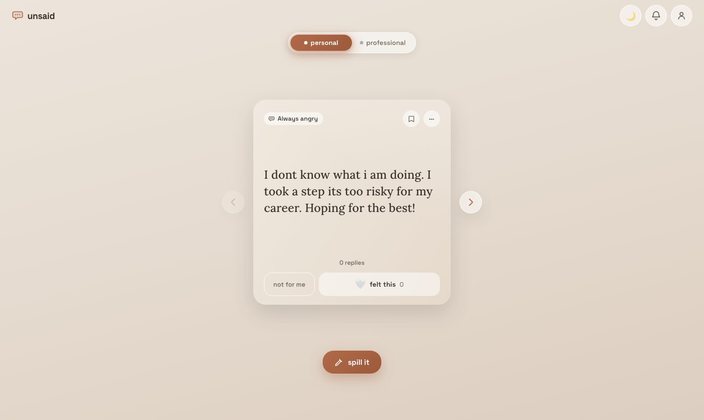
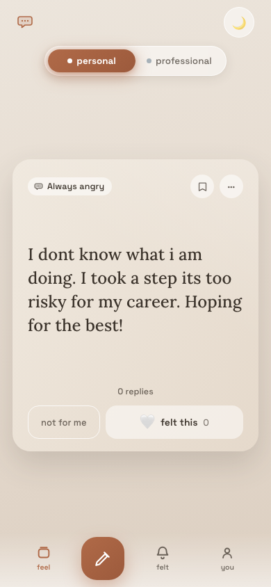

# unsaid

> say the thing you've never said. nobody knows it's you. everybody feels it.

**Live: [unsaidnow.vercel.app](https://unsaidnow.vercel.app)** · **Case study: [nc-designs.vercel.app/case-study/unsaid](https://nc-designs.vercel.app/case-study/unsaid)**

<p align="center">
  
  
</p>

An anonymous confessions app with two worlds, personal and professional. Swipe feed, empathy-first reactions, comments, moderation, and a PWA install flow.

Designed and built solo in three weeks. Figma for the design system, Claude Code as my pair programmer for the build.

## How design maps to code

The design system lives in code, not just in Figma.

- `packages/tokens` holds every world, mood, topic and gradient as typed TypeScript, with the same names as the Figma variables.
- `apps/web/src/lib/theme.ts` turns those tokens into CSS custom properties, with light and dark pairs resolved per scope.
- Components use the variables (`--accent`, `--sp-2`, `--r-card`), never hardcoded values. Change a token once and every screen updates.
- `apps/web/src/lib/useDialogA11y.ts` handles focus trapping, Escape and focus return for every overlay. `prefersReducedMotion` guards every animation. Tap targets are a token (`--tap-min: 44px`).

Open `ConfessionCard.tsx` next to the Figma component and the props match the variants.

## Product decisions that live in the code

**The anonymity invariant.** `author_id` never leaves the server. Clients read posts and comments only through views that have no author column, and every write goes through an edge function, so moderation and rate limits can't be bypassed. A test in `tests/anonymity.test.mjs` guards this.

**Safety by design.** No dislike button, no DMs, no images, no public profiles, a 500-character cap and a per-post replies-off switch. Every post is moderated before it publishes (rules plus AI moderation via Groq, with OpenAI as fallback). A crisis interstitial shows helplines rather than silently blocking. Three reports auto-hide a post and send it to a human queue at `/admin`. Users can mute an author without learning who they are, and deleting an account really deletes it.

The reasoning behind these is written up in `docs/` (moderation policy, privacy policy, what anonymous means).

## Built with

Next.js 15, React 18, TypeScript, CSS Modules, Supabase (Postgres, row-level security, edge functions), Expo for iOS, Vercel.

## Status

The web app is live. The iOS app in `apps/mobile` is built and waiting on an Apple Developer account.

## Repo layout

```
apps/web         Next.js: public feed, share pages (/p/[id]), /admin moderation
apps/mobile      Expo iOS app (expo-router, Reanimated swipe feed)
packages/tokens  Design tokens (worlds, moods, gradients) and shared types
packages/api     Typed Supabase access layer used by both apps
supabase/        Migrations, row-level security, views, edge functions, seed data
docs/            Privacy policy, moderation policy, App Review notes
```

## Run it locally

Needs Docker and the Supabase CLI.

```bash
pnpm install

supabase start            # local Postgres, auth and functions
supabase db reset         # applies migrations and seed data
supabase functions serve  # edge functions, reads supabase/.env

cp apps/web/.env.example apps/web/.env.local   # add your Supabase URL and keys
pnpm web

cp apps/mobile/.env.example apps/mobile/.env
pnpm mobile               # iOS simulator
```

Edge functions need `GROQ_API_KEY` or `OPENAI_API_KEY` for moderation.
